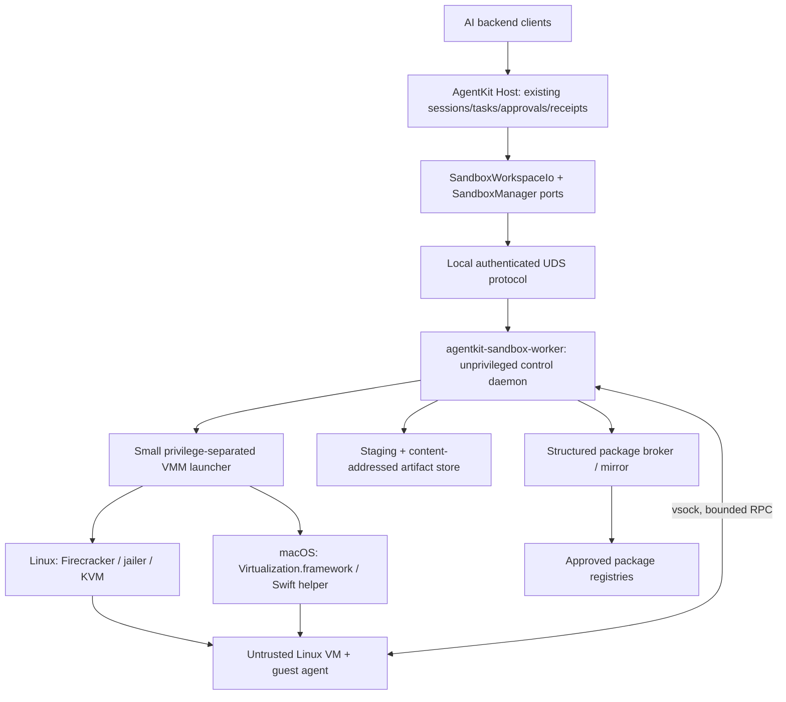
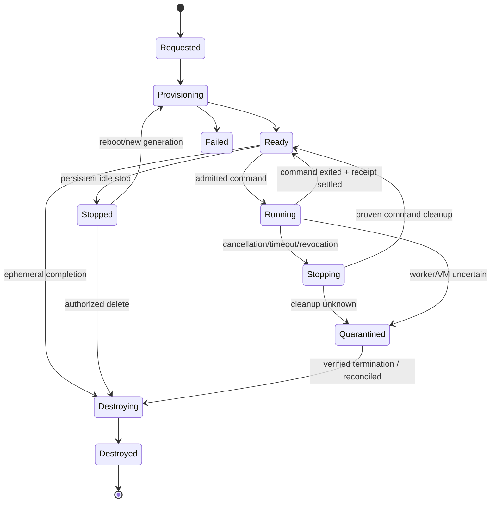
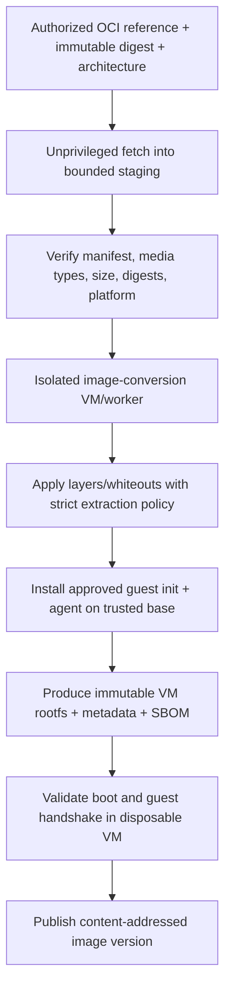
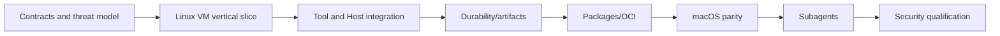

# AgentKit VM Sandbox Runtime — Implementation Specification

**Status:** implementation specification / proposed architecture — not a claim of implementation or security qualification  
**Version:** 1.0 draft, 2026-11-08  
**Project:** [andrejvysny/AgentKit](https://github.com/andrejvysny/AgentKit)  
**Source baseline inspected:** `master` commit `8b6741e6bc455453aa396fcad521d8dfb0820da3` (2026-11-07)  
**Suggested destination in repo:** `docs/specs/sandbox-runtime.md`  
**Approval:** design decisions supplied by the project owner; no Plane/GitHub mutation authorized by producing this document  
**Primary implementer:** OMP Goal Mode using Qwen3.8 Flash Next

## 0. Contract, language and definition of success

The words **MUST**, **MUST NOT**, **SHOULD**, and **MAY** are normative. Security invariants are mandatory and must be verified rather than assumed. `AgentKit Host` refers to the existing authoritative Rust host/task/run system. The new `Sandbox Worker` is a separate operating-system process or service, **not** a second agent runtime or authoritative task scheduler. Example Rust definitions below are **proposed contracts**, not currently existing APIs or compilable drop-in code; implementation must adapt names to the repository while keeping semantics.

**Goal:** enable general Chat, coding, research, and subagent tools to perform filesystem operations, execute arbitrary untrusted code, and install authorized packages inside a Linux VM isolated from the host and other tenants. Agent orchestration and model inference remain outside the VM initially. No unrestricted external coding-agent CLI execution is included in this release.

**Success is not merely compiling a VM launcher:** the AgentKit tool pack must route all sandbox-bound filesystem, search, Git, command, and test operations through the guest. Multi-tenant ownership and authorization, lifecycle, private persistent volumes, OCI-to-VM image conversion, denied-by-default networking with package broker, artifacts, recovery, Linux/macOS parity, and real-host adversarial tests are necessary for a qualified complete release. Where specific host hardware is unavailable, declare the platform **unqualified** and the goal **incomplete/blocked**; never invent proof.

## 1. Binding product decisions

| Topic | Binding decision |
|---|---|
| Consumers | Backend AI systems with potentially **multiple hostile/untrusted tenants** |
| Initial deployment | Sandbox workers **co-located with the AI backend server** as separate, least-privilege OS services; optional remote workers later |
| Host platforms | **Linux and macOS**, both first-class supported platforms; real hardware qualification required for both |
| Guest OS | Linux on both platforms, arch-matched to host (`x86_64`/`aarch64` as supported by backend) |
| Mandatory security tier | Hardware-virtualized microVM/VM; no container substitution for hostile workloads |
| Linux backend | Firecracker + KVM + jailer, with supported version pinned and documented |
| macOS backend | Apple Virtualization.framework with a minimal Swift host adapter; Rust control/data plane |
| Optional container tier | Separate, explicitly weaker policy in a future milestone; not an automatic fallback |
| Guest tools | Shell commands, file read/write/edit/search, Git inspection, tests and package installs |
| External coding agent CLI | Not in v1: sandbox **tool execution only** |
| Files | Approved staged import; separate reviewed/exported publication; **no host bind mounts** |
| Persistence | Ephemeral and persistent named environments; private per tenant/user/agent by default |
| Network | No VM network device by default; package fetch only through an authenticated host broker over vsock; allowlist is structured by artifact, not an open HTTP proxy |
| Images | Curated reproducible Linux VM images plus user-supplied OCI images **converted safely** to versioned VM root filesystems |
| Multi-agent | Child inherits or narrows sandbox authority, never widens it; default single writer per private workspace |
| Control plane | Reuse existing AgentKit Host admission, tasks, attempts, receipts, approvals, governance and recovery |
| Language | Rust for portable contracts, guest agent and worker; thin Swift adapter for macOS VMM APIs |
| Project records | Do not edit Plane or GitHub without separately requested authorization; source-bound specs/tests live in Git |

### Deployment reconciliation: co-location versus remote-first

"Remote-server-first" means clients invoke AgentKit through a backend server, not the user laptop. Initially, `AgentKit Host` and `Sandbox Worker` run on the **same backend machine** but in distinct security domains, connected by a mutually authenticated / OS-credential-checked **local Unix-domain socket (UDS)**. Do not build distributed-worker orchestration solely to meet v1. Introduce `WorkerTransport` so a later mutually authenticated remote transport can reuse the protocol and trust model. Never treat co-location as equivalent to dedicated sandbox hardware: a hypervisor escape or privileged-helper compromise could still affect the backend application. The production deployment guide MUST state the risk and strongly isolate database/model credentials from the worker, even when co-located.

## 2. Repository baseline and integration seams

Inspect actual code before changing it; documentation below reflects the pinned source baseline:

- `rust/crates/toolpacks-coding/src/{fs_tools.rs,search_tools.rs,git_tool.rs,exec_tools.rs}`: existing tools perform direct host I/O or host process execution. **Every sandbox-bound path must move behind a guest I/O service**; changing only `run_command` is insufficient.
- `rust/crates/toolpacks-coding/src/{sandbox.rs,types.rs,pack.rs,guard.rs}`: Seatbelt `sandbox-exec` is a macOS host-process constraint, not VM isolation; `SandboxMode::{Required,Off}` is the legacy command-policy surface. Keep legacy behavior compatible, and add a **separately named isolated VM execution target** so an isolated session can never downgrade to `Off`.
- `rust/crates/toolpacks-coding/src/{process.rs,coordination.rs,coordination_lockdir.rs}` and `docs/adr/0020-execution-ownership-and-recovery.md`: process-group ownership and lock-dir leases assume a local host/OS user/PID namespace. These cannot be reused as proof that a remote or guest execution ended. Introduce sandbox- and command-generation fencing, external-effect reconciliation and VM quarantine.
- `rust/crates/host/src/governance/{durable_execution.rs,staging.rs}`: authoritative task admission, human approvals, durable side-effect receipts; extend, do not fork.
- `rust/crates/host/src/session/descriptor.rs`: versioned session descriptor currently includes optional `{root,trusted}` workspace; add a distinct, versioned, backward-compatible **sandbox binding** and validate tenant/ownership in host state, never solely from user-provided metadata.
- `rust/crates/host/src/subagents/{service.rs,guard.rs}`: delegation and local workspace leases exist; extend authorization to private sandbox identity + generation and durable writer fencing.
- `rust/crates/napi/src/coding_lane.rs`: Rust coding tools are registered in one native lane with a guard; preserve TS/Bun compatibility and avoid a separate JavaScript execution path.
- `docs/adr/0018-coding-tool-pack.md`: historical coding-pack semantics and legacy restrictions must remain for explicitly selected host mode.
- Existing Plane context (read-only): AGENTKIT-39 coding pack; AGENTKIT-77 coding environment; AGENTKIT-103 worker trust; AGENTKIT-104 task dispatch/fencing; AGENTKIT-105 secrets/artifacts. Coordinate conceptually; create no duplicate planning authority.

Before implementation, read repository instructions and current code (the pinned commit may become outdated). Add an ADR explaining changed workspace routing, isolation guarantees, backward compatibility and security non-goals.

## 3. Threat model and trust boundaries

### 3.1 Adversary

Assume arbitrary malicious native code can run as guest root, including untrusted package install scripts, generated shell commands and poisoned source archives. Assume the attacker can control all guest filesystem bytes and stdout/stderr, may send malformed guest protocol frames, induce crashes/resource exhaustion, and attempt network/host/neighbor access. Assume different tenants actively attack each other. Treat model-generated tool input as untrusted. Do **not** rely on prompt instructions, command-text filters or the guest's cooperation as a security control.

### 3.2 Assets to protect

Backend process and its credentials; model/provider keys; database; host OS and hypervisor APIs; package broker credentials; other tenants' VM disks, command output and artifacts; policy/configuration and authorization records; host resource availability; integrity of user-selected original files.

### 3.3 Trusted computing base (TCB)

- AgentKit host authorization/receipts and control plane, worker control binary, privileged VM launcher, hypervisor/KVM or Apple virtualization, host OS, image builder, artifact/package broker.
- **Guest OS, guest agent and all guest code are untrusted.** Guest responses are observations, never authorization. Compromised guest service can lie about command status, so host must distinguish guest-reported outcome from independently verified VM termination.
- A guest-boot nonce/handshake is a channel association, not remote attestation or proof of benign guest software.

### 3.4 Residual risks / limits of guarantees

Hardware virtualization reduces attack surface but does not make VM escapes impossible. Co-located backend and worker share a physical kernel/hypervisor TCB. CPU cache/speculative channels, host administrator compromise, shared storage hardware, and malicious data intentionally submitted to model/output channels are not fully prevented by VM isolation. An agent may include user-provided secrets in its own results unless higher-level content policy forbids it. Brokered package fetches are still an external observable communication channel and require strict request shaping. No claim of absolute isolation is permitted.

### 3.5 Non-negotiable security invariants

- **S01**: Every VM has one server-derived `tenant_id`, one private `sandbox_id`, a versioned `instance_generation`, one effective policy version/digest and bounded resource reservations.
- **S02**: Tenant identity is inferred from authenticated server context; client or model parameters cannot select another tenant.
- **S03**: No host directories, home folders, Docker sockets, KVM devices, SSH agents, host processes or privileged host IPC are mapped into guests.
- **S04**: Guest receives no general network device by default. Package access is via narrowly scoped broker over vsock; no direct DNS, IPv4, IPv6, Unix host sockets or metadata endpoint access.
- **S05**: VM launch fails closed without verified hardware virtualization and required host privileges/entitlements. Never substitute `sandbox-exec`, host shell or Docker transparently.
- **S06**: All sandbox-bound tool I/O goes through sandbox service. No native host read/search/git/exec fallback, including after guest timeout or error.
- **S07**: Every external mutation is authorized by the existing Host policy and fenced by immutable command identity before dispatch; failures after dispatch can be **uncertain**, not automatically retryable.
- **S08**: Worker and guest cannot mint/widen grants. No subagent can exceed parent + role + tenant + session policy intersection.
- **S09**: A sandbox has one admitted writer at a time; overlapping guests/disk mounts and stale write generations are refused.
- **S10**: Host-only credentials stay host-only; guest environment constructed from an explicit allowlist, with optional approved short-lived task-scoped values only if a later separately reviewed feature permits them.
- **S11**: User OCI content never executes, extracts with ambient host privileges, or gets treated as trusted during conversion. Build/conversion of adversarial content is itself isolated.
- **S12**: Imports and exports verify paths, ownership, sizes, object types, digest, limits and grant; exports never write original user paths directly.
- **S13**: Tenant-scoped quotas include vCPU, RAM, disk, process count, VM count, command wall time, artifacts, logs and broker traffic; reservation and release are transactional/fenced.
- **S14**: Guest/worker termination or disconnection cannot be treated as proof of effect rollback. Unknown execution or cleanup quarantines resource until reconciliation.
- **S15**: Persistent sandboxes cannot transfer to another tenant or new image/policy generation without explicit controlled migration; deletion is fenced and verified.
- **S16**: Every protocol frame, path, environment value and log stream is length- and time-bounded with version negotiation and duplicate suppression.
- **S17**: Guest artifacts and stdout/stderr are untrusted data. They cannot authorize actions, change policy, or inject host control commands.
- **S18**: Audit traces record IDs/digests/decisions and status while excluding provider keys, bearer secrets and uncontrolled private file content.
- **S19**: Every feature advertised as portable passes real Linux and real macOS tests, or reports an unsupported capability; no silent skip masquerading as success.
- **S20**: No privileged daemon accepts a raw command path, arbitrary host mount, unrestricted image extraction path, or caller-controlled hypervisor socket path.

## 4. Architecture and process topology



**Co-location:** Host and Worker run on the same backend server, with separate OS identities, separate credential files, separate writable state, hardening (Linux systemd service protections; macOS launchd/process entitlements), and a tightly restricted UDS. Linux may require privileged operations for KVM/cgroups/jailing; implement these in a narrowly scoped, audited helper, not by making the AgentKit HTTP/API process root. macOS VM control should execute in a separate signed/entitled helper; Swift is a thin FFI/IPC adapter, not another task scheduler.

**No new authoritative queue:** AgentKit Host owns logical tasks and results. Worker persists **physical** VM/command inventory and journals effects to reconcile crashes, but must not schedule new agent tasks independently.

**Remote compatibility:** `WorkerTransport` supports a local UDS in v1; remote mTLS is a future adapter and must not be used as an excuse to skip local worker hardening. Do not assume UDS peer identity works identically on macOS and Linux; implement and test platform-specific peer checks (`SO_PEERCRED` or equivalent on Linux; `getpeereid` on macOS) and filesystem permissions.

## 5. Domain model, identifiers and durable state

### 5.1 Identities

- `tenant_id`: server-derived tenant; mandatory on every query, record and artifact.
- `principal_id`: authenticated user/service within tenant; scopes access to a private sandbox.
- `agent_id`, `session_id`, `task_id`, `attempt_id`: existing AgentKit identities, not new competing task records.
- `sandbox_id`: random opaque stable identity for a named/ephemeral workspace.
- `instance_generation`: monotonic new generation for each VM creation/restart/restore; stale generations refused.
- `worker_id`: local host worker stable identity with revision and installation fingerprint.
- `policy_generation` and `policy_digest`: pinned effective security policy; revocation can force running VM stop.
- `execution_id` + `tool_call_id` + `request_digest`: stable idempotency/receipt identifiers.
- `image_digest`, `artifact_digest`: content-addressed SHA-256 roots, verified at ingestion and use.

Use explicit types/newtypes; reject malformed/empty IDs and cross-tenant references. Never use user-provided file paths as sandbox ownership keys.

### 5.2 Sandbox specification (illustrative wire JSON)

```json
{
  "version": 1,
  "owner": { "kind": "agent", "id": "agent-id" },
  "lifecycle": "persistent",
  "image": { "digest": "sha256:...", "os": "linux", "arch": "aarch64" },
  "resources": {
    "vcpus": 2,
    "memory_mib": 2048,
    "writable_disk_mib": 8192,
    "max_processes": 128,
    "command_timeout_sec": 300,
    "max_log_bytes": 1048576
  },
  "network": { "mode": "packages_only", "registry_policy_id": "curated-v1" },
  "retention": { "idle_stop_sec": 900 },
  "workspace": { "root_in_guest": "/workspace", "host_mounts": [] }
}
```

`tenant_id` is **intentionally omitted** from untrusted wire inputs: the host injects it from authenticated context. Internal worker commands carry an already authenticated tenant binding and validated authorization envelope. Limits are **server-clamped**, never blindly accepted. `host_mounts` must be empty for the VM security tier; reject any nonempty array (don't ignore it).

### 5.3 Default resource profile (configuration, not promised measurement)

Ephemeral: 2 vCPU, 2 GiB RAM, 8 GiB writable disk, 5-minute command deadline, package-only network. Persistent: 2 vCPU, 4 GiB RAM, 20 GiB disk, 10-minute command deadline, stop after 15 idle minutes. All defaults are administratively configurable and constrained by per-tenant and physical-host admission ceilings. Reserve memory/disk before provisioning and account for concurrent builds, logs and image caches. Do not overcommit beyond administrator policy.

### 5.4 Durable records

Minimum records: sandbox configuration, owner, lifecycle state, image and policy digests; VM generation, worker identity, private disk location and checksum; resource reservation; command authorization/dispatch/ack/result/cleanup record; import/export staging and content digests; leases and quarantine reason; broker policy revision; event cursor; full reviewable but redacted audit of sensitive decisions. Use the existing AgentKit store architecture and transactional migrations, never a second application-wide task database. Worker-local journals may be separate physically to enable independent crash discovery but must reconcile with host task receipts.

Avoid any attempt to promise an atomic transaction across database and hypervisor side effects. On crashed/unknown external effects, propagate `uncertain` and require reconciliation or renewed authority.

## 6. Public service and backend contracts

### 6.1 Layers

1. `SandboxManager`: trusted host-facing lifecycle service with caller-context authentication; no direct exposure to models without governance.
2. `SandboxWorkspaceIo`: typed file/search/git/command interface used by **every** coding pack operation.
3. `SandboxBackend`: physical VM lifecycle by platform, called inside Worker.
4. `GuestRpc`: framed, bounded, versioned control/streaming over vsock.
5. `ImageBuilder` and `PackageBroker`: separately authorized, untrusted-input-aware paths.

### 6.2 Proposed Rust interfaces (semantics are authoritative, exact names not)

```rust
#[async_trait]
pub trait SandboxManager: Send + Sync {
    async fn capabilities(&self, ctx: &AuthContext) -> Result<CapabilityManifest>;
    async fn create(&self, ctx: &AuthContext, spec: SandboxSpec) -> Result<SandboxRef>;
    async fn start(&self, ctx: &AuthContext, id: SandboxId) -> Result<SandboxState>;
    async fn inspect(&self, ctx: &AuthContext, id: SandboxId) -> Result<SandboxState>;
    async fn stop(&self, ctx: &AuthContext, id: SandboxId) -> Result<SandboxState>;
    async fn destroy(&self, ctx: &AuthContext, id: SandboxId) -> Result<DeletionReceipt>;
}

#[async_trait]
pub trait SandboxWorkspaceIo: Send + Sync {
    async fn read(&self, grant: &WorkspaceGrant, path: &GuestPath,
                  options: ReadOptions) -> Result<ReadReply>;
    async fn write(&self, grant: &WorkspaceGrant, path: &GuestPath,
                   body: BoundedBytes, expected_sha256: Option<Sha256>) -> Result<WriteReceipt>;
    async fn list(&self, grant: &WorkspaceGrant, path: &GuestPath,
                  options: ListOptions) -> Result<ListReply>;
    async fn search(&self, grant: &WorkspaceGrant,
                    query: SearchQuery) -> Result<SearchReply>;
    async fn git_inspect(&self, grant: &WorkspaceGrant,
                         query: GitInspectQuery) -> Result<GitInspectReply>;
    async fn exec(&self, grant: &WorkspaceGrant,
                  request: ExecRequest) -> Result<ExecutionHandle>;
}

#[async_trait]
pub trait SandboxBackend: Send + Sync {
    async fn probe(&self) -> Result<BackendCapabilities>;
    async fn provision(&self, spec: &VerifiedLaunchSpec) -> Result<VmHandle>;
    async fn launch(&self, handle: &VmHandle) -> Result<VmObservedState>;
    async fn terminate(&self, handle: &VmHandle) -> Result<TerminationEvidence>;
    async fn inspect(&self, handle: &VmHandle) -> Result<VmObservedState>;
}
```

`WorkspaceGrant` must be a host-created effective capability, bound to tenant, principal, session/task, sandbox, instance generation, policy generation, tool capability, expiry and intended request. A guest cannot create or extend it. Do not serialize a reusable bearer token into the guest filesystem. Every worker action checks the grant server-side against authoritative state.

**Important:** Existing `edit_file` semantics (expected hash, ambiguity checks, CRLF/BOM preservation), search/Git sanitization and output caps must survive adapter migration. Either execute these algorithms in a verified guest-side implementation or perform them in the host on **guest-provided bytes** with safe bounded reads and guarded atomic write. Never materialize guest files under a general host path for a tool to inspect.

### 6.3 Host-facing API and permissions

Expose a versioned domain API through existing AgentKit service/port boundaries (and existing authenticated HTTP/TS/N-API facades where appropriate). Do **not** expose unauthenticated public VM controls or create an independent authorization service. Minimum operations:

- `createSandbox`, `listSandboxes`, `inspectSandbox`, `startSandbox`, `stopSandbox`, `destroySandbox` (management rights only).
- `bindSandboxToSession` (owner check; versioned immutable binding for active run), `getSandboxCapabilities`.
- `importSandboxArtifacts` (explicit source/artifact grant and staged copy).
- `exportSandboxArtifacts` (signed/hash-verified manifest; publication is a **separate** authorized application operation).
- `execSandboxCommand`, `cancelSandboxCommand`, `streamSandboxExecution` (run/tool rights, not VM-admin rights).
- `listSandboxFiles`/`readSandboxFile`/`writeSandboxFile` (path-specific rights, limits).

Separate `sandbox.manage`, `sandbox.read`, `sandbox.write`, `process.exec`, `artifact.import`, `artifact.export`, `network.package_fetch`, `image.import` capabilities. The existing `CodingPermissionGuard` and high-risk-command rules remain authoritative; new sandbox policy is an **additional AND gate**, not a replacement.

### 6.4 Wire protocol — worker and guest

Use a versioned, bounded schema, e.g. Protobuf or framed CBOR/JSON if justified. No handwritten ad-hoc delimiter protocol. Frame includes `protocol_version`, `request_id`, `sandbox_id`, `instance_generation`, `execution_id?`, `operation`, `sequence`, `deadline`, `payload_len`, and `payload_digest` when moving bytes. Authenticated host-to-worker messages also bind tenant and policy generation. Strictly reject unknown critical fields, unsupported versions, duplicate conflicting requests, oversized frames, integer overflow, stale generation and expired deadlines.

Command result events: `accepted`, `spawned`, `stdout_chunk`, `stderr_chunk`, `resource_update`, `exited`, `termination_observed`, `uncertain`, `truncated`. Bound stdout/stderr per chunk and total, enforce backpressure, and explicitly mark truncation. `accepted` does not mean `spawned`; `cancel_requested` does not mean stopped. Reconnect uses a cursor and can request resynchronization; never fabricate missing output.

Command input supports an executable+argv form and a compatibility `shell` form (fixed guest shell only). Command-text heuristics cannot serve as a security boundary. Use a dedicated guest user by default; guest-root may be allowed by policy because guest remains the untrusted isolation domain, but no host privilege transfers. Guest cwd must be under the approved guest workspace; variables start from an explicit guest allowlist and scoped values, never host environment inheritance.

### 6.5 Error contract

Stable machine-readable error codes, including `sandbox_not_found`, `tenant_forbidden`, `sandbox_policy_denied`, `sandbox_capability_unsupported`, `sandbox_isolation_unavailable`, `sandbox_unavailable`, `sandbox_stale_generation`, `sandbox_quarantined`, `sandbox_resource_exhausted`, `sandbox_image_invalid`, `sandbox_image_unsupported`, `sandbox_package_denied`, `sandbox_artifact_invalid`, `sandbox_execution_not_started`, `sandbox_execution_uncertain`, `sandbox_termination_unverified`, `sandbox_protocol_incompatible`.

Differentiate: denied before start (safe to retry only after a fresh authorizing decision); dispatched but not acknowledged (uncertain, reconcile); proven exited (result may be replayed by ID); VM/worker lost (uncertain until proven); poisoned/suspect artifact (quarantine and reject). Avoid generic `command_failed` for security-critical distinctions.

## 7. Lifecycle, state machine and consistency



- `Requested` creates immutable sandbox identity and reserves quota before launch.
- `Provisioning` verifies image and policy, prepares private disk, performs VM creation under the worker helper, and records host-observed VM identity.
- `Ready` requires a healthy *authenticated channel association*, matching image and policy digests, guest RPC compatibility, and health probe. Guest code remains untrusted.
- `Running` uses one exclusive workspace write lease for every mutation, including package installs. Read-only queries may run concurrently only when consistency is defined.
- `Stopped` means **VM physically stopped**, not only user-requested stop; physical evidence must accompany status.
- `Quarantined` denies all new reads/writes/exec/export that could violate policy until investigation/reconciliation; a private persistent disk may be retained for controlled recovery.
- `Destroying/Destroyed`: reference-count image/cache safely, erase private ephemeral storage, release reservations only when cleanup and storage deletion are verified; report partial cleanup truthfully.
- Every boot/restart/restore increments `instance_generation`. Never reuse command/process authorization across generations.

**Persistence:** persist **private disk**, not active RAM, as the required v1 feature. VM memory snapshots, hot migration and warm pools are optimizations after security qualification; neither is needed for this release.

**Crash points to test:** before/after DB admission, resource reservation, VM creation, guest handshake, command dispatch, guest spawn, result, receipt commit, artifact staging, stop acknowledgment, storage deletion. Restore authoritative host state and reconcile worker-local journal. If state cannot be proven, quarantine; do not self-retry an ambiguous command.

## 8. Guest runtime and tool semantics

### 8.1 Guest agent

Build a small Rust Linux guest process managed by the guest's init/supervision. It serves only the configured host-vsock endpoint; does not open a TCP listener; authenticates session association and protocol version; validates every length/path/command bound; emits structured execution events and file operation results. Startup MUST refuse a missing/incorrect boot nonce, unsupported protocol, or missing private workspace disk. The host MUST distrust guest status claims that conflict with independently observed VM process state.

The guest process may be compromised as part of the assumed threat model. Thus: (a) only host-side policy decides tenant, authority and lifecycle; (b) no host path is writable through guest RPC; (c) no guest request is implicitly a worker admin command; (d) broker calls require a separate host-side authorized operation, not merely an authenticated guest agent.

### 8.2 Filesystem semantics

- `/workspace` is an isolated private filesystem with deterministic working directory and no host-mounted source tree.
- `/home/agent` and `/tmp` are guest-only, quota-enforced and initialized per sandbox, with private permissions.
- Implement `read`, `write`, `edit`, `list`, `search`, `git_inspect` with compatible behaviors to existing Rust coding pack. Keep expected-SHA conflict checks and atomic writes.
- Normalize paths; reject absolute path outside approved guest roots, `..` escape, dangerous encoded names, NUL, symlink and hardlink tricks, device/FIFO/socket targets where inappropriate, and concurrent rename races. Where Linux host/guest path security benefits from `openat2` with `RESOLVE_BENEATH`, `RESOLVE_NO_MAGICLINKS`, `RESOLVE_NO_SYMLINKS`, use a guarded implementation; avoid time-of-check/time-of-use holes.
- A guest-local process may legitimately read/write other files *inside its own guest OS* (e.g., package installation). Preventing this is not the same goal as preventing the guest from reaching the host.
- A file that changes during read/export must fail integrity checks, not return a supposedly stable digest.
- Guest native operations cannot bypass the host authorization gate simply by arriving through an alternate tool namespace or agent/subagent.

### 8.3 Commands, processes and cancellation

- Never execute guest commands as host shell or `docker exec` on the backend.
- Admit commands with host durable receipt + active sandbox generation + quota reservation + capability check, then forward to guest. Persist `dispatched`, `spawned`, `exited`, `cleanup_verified` separately.
- Inside the guest use process groups/cgroups and a local command supervisor to enforce command timeout, stdout/stderr caps, process count, cancellation and descendant cleanup. If descendants cannot be proven stopped, terminate the *entire VM*; for persistent sandboxes, mark its disk as requiring integrity checks or quarantine if state is uncertain.
- Limit environment variables by name, value length and total bytes. No inherited backend `HOME`, `PATH`, proxy credentials or `SSH_AUTH_SOCK`.
- Provide streaming chunks with stable cursor/order, truncation flags, exit status, signal and timing; absence of exit status is not success.
- `run_tests` preserves exact configured-command matching and existing approval model.
- Arbitrary shell text is permitted as guest input once authorized, because isolation is enforced by the VM, not command string scanning. Existing high-risk command authorization remains intact.
- Idempotency: a duplicate `execution_id` with an identical digest can return a recorded result without rerunning; conflicting digest is an error. If worker/guest loss makes completion unknowable, return **uncertain** rather than rerun.

### 8.4 Git semantics

Run Git inspection inside guest with existing safety args (no external helper/pager/credential manager, hooks/filters disabled for inspection); preserve private `.git` policies. A user-controlled Git repository must not be allowed to run arbitrary host-side helper programs. `git clone` inside guest requires an explicit network capability and is **out of scope for `packages_only`** unless implemented as controlled host-side source import. Publishing Git commits back to the user's original repository is separate from artifact export and requires an application-side authorization.

## 9. Package network broker (deny by default)

### 9.1 Network design

The VM is configured without an ordinary NIC, DHCP, guest DNS or host-network bridge. Guests communicate with worker only on one constrained vsock service. A guest-local package client/proxy shim (or package-manager-specific resolver) uses vsock to request package artifacts; host worker forwards only approved **structured package requests** to trusted registry mirrors. A generic `CONNECT` tunnel or free-form URL-fetch method MUST NOT exist in `packages_only` mode. The broker does not expose cloud metadata, loopback backend services, RFC1918/private addresses or internal host networks.

Broker request concept:

```json
{
  "version": 1,
  "ecosystem": "pypi",
  "package": "requests",
  "version": "2.32.3",
  "artifact_digest": "sha256:...",
  "sandbox_generation": 4
}
```

Approved registries: PyPI, npm and crates.io first. For npm scoped packages, tarballs and Python wheels/sdists, broker must validate artifact metadata, filenames, digests and redirects against a frozen registry/mirror policy. Lockfile and index metadata are read only through approved endpoints. Reject arbitrary query strings/paths that could be used for exfiltration. Artifact content may still be malicious; it is installed/executed **only in the guest**. TLS validation stays enabled. Define cache keys including registry origin, content digest and policy generation, and isolate tenant-private metadata.

### 9.2 Functional requirements

- Make `pip install`, `npm install`/`npm ci` and `cargo fetch` work when the selected base image includes those tools, under an approved policy. For a minimal runtime missing a tool, give an actionable unsupported-tool result rather than inventing success.
- Redirect handling must revalidate destination, artifact identity, scheme, maximum size and time at *every* hop.
- Enforce request count, total bytes, rate limit, per-tenant broker budget and output size/time caps.
- In `offline` mode the broker refuses all external requests. In `packages_only`, `curl example.com`, arbitrary DNS and arbitrary HTTP/HTTPS must fail from guest even if package installs work.
- Future `restricted` mode requires separate capability and domain/URL policy (not part of minimum security qualification).
- Deterministic tests need a local fake registry service that exercises authentic broker rules; a real approved-registry test may require explicit network-enabled CI and must be labeled as such.

**Security qualification note:** a domain allowlist + general HTTP proxy is **not** enough for a hostile tenant, because request paths/queries can encode secrets. Implement a structured resolver/mirror, or explicitly mark a weaker general-proxy mode as not meeting this spec.

## 10. OCI image ingestion and VM root filesystem creation

### 10.1 Meaning of "trusted VM image"

Here **trusted** means *format-validated, provenance-pinned, bootable under an administrator-controlled kernel/init/guest-agent contract*, **not** that user-supplied OCI package content is benign. The rootfs remains untrusted at runtime. Do not label it safe merely because its OCI digest or signature verifies. Registry trust and vulnerability scanning are additional policy signals, not replacement for VM isolation.

### 10.2 Image import pipeline



**Never** run arbitrary Dockerfile `RUN`, `ENTRYPOINT`, package scripts, OCI hooks or extracted binaries in a privileged host image-builder process. For v1, **import OCI images by digest** and convert layers; arbitrary Dockerfile builds are a separately gated capability that must run in an isolated build VM if added later. OCI import must not require installing Docker or mounting the host Docker socket.

### 10.3 Supported image subset for v1

- Linux OCI images matching the selected host/guest architecture; no cross-architecture emulation promise.
- Only documented Linux distributions/rootfs layouts (begin with Debian/Ubuntu-compatible images; widen after tests). Arbitrary `scratch`, distroless, non-Linux, missing shell/package manager and multi-process entrypoint images may be unsupported for coding tools. Capability discovery reports exactly why.
- Reconstruct OCI layers/whiteouts under OCI specification, without running container entrypoints; inject a controlled guest init/agent and boot configuration, preserving user filesystem content as separate trust domain. Avoid clobbering the guest agent through overlay ordering.
- Handle malicious tar entries: reject absolute paths, `..`, duplicate/ambiguous members, symlink/hardlink escapes, device nodes, FUSE mounts, special files, unexpected xattrs, setuid/setgid flags, file capabilities and huge sparse members according to documented policy. Bound decompressed bytes, file count, depth, name length and CPU/time.
- Format/boot validation occurs inside a disposable VM and includes protocol readiness, expected architecture/kernel, read-only base root and writable overlay.
- Base kernel/guest agent are administrator-managed, pinned and regularly patched; user-supplied kernel is not part of v1.
- Store immutable image metadata: OCI digest(s), architecture, conversion version, guest-agent version, trusted kernel digest, rootfs digest, scan results, policy digest, provenance and import time. A mutated image version creates a new digest, not in-place overwrite.

### 10.4 Runtime storage

Boot from immutable read-only base image plus **private** writable overlay/disk. Persistent sandbox retains only private disk state across VM reboots. Prevent double-mount/race access to writable disks. Hard quotas and fullness detection apply to sparse allocation as well as logical size. Encrypt persistent disk files at rest where supported by server policy, with tenant-separated key custody. Cache images across tenants **only if content-addressed, immutable, and free of tenant secrets**. Guest state and package caches are private unless explicitly allowed in a validated immutable shared image.

## 11. Artifact staging, import, export and publication

### 11.1 Import

- Only trusted applications/users with `artifact.import` grant can select source artifact IDs or approved files. No raw arbitrary host path supplied by model reaches the worker.
- Host validates selection, access, version, file names/types/sizes/count and expected digest; packages data in bounded authenticated transfer. Store in restricted staging then copy into guest workspace.
- Reject traversal, absolute/dot paths, symlink/hardlink escapes, device nodes, archives with bombs, Unicode/path collisions, inconsistent manifests, hidden cross-tenant references and digest mismatches.
- Imported files may contain malicious content; guest execution and tools must treat it as data.

### 11.2 Export

- Requested outputs are explicit guest-root-relative paths or selected changes, under `artifact.export` policy. Gather bounded files with immutable manifest, SHA-256 digest, original baseline identifier (where applicable), size, MIME/type and provenance: tenant, sandbox, generation, task, execution IDs.
- Host verifies transmitted bytes, manifest, decompression limits and staged object type, and stores them in private content-addressed artifacts. Malicious SVG/HTML/scripts remain untrusted; user interface must not execute them with host privileges.
- **Export does not publish to source repository.** Original workspace merge, Git update or file overwrite occurs through a separately authorized destination adapter, with conflict detection and user review policy.
- Deny export after stale generation, revocation, cross-tenant access or unresolved command cleanup unless a deliberate administrative recovery workflow permits an evidence-only export.

### 11.3 Reproducibility

For every returned artifact expose a stable digest and source identity, never an unverifiable guest absolute host path. Preserve audit chain from imported revision to generated revision; mark missing partial outputs after crash as `uncertain`.

## 12. Platform backends and parity requirements

### 12.1 Linux: Firecracker/KVM

- Probe architecture, `/dev/kvm`, KVM permissions, kernel compatibility, cgroups v2, jailer executable, compatible Firecracker version and required security facilities before accepting workloads.
- Create per-sandbox identity, jailer chroot, seccomp profile, dropped capabilities, unprivileged runtime process, separate disk paths, secure Unix API/vsock sockets and cgroup vCPU/RAM/pids/resource ceilings.
- Do **not** grant privileged container or VM runtime daemon access to guest. Guest has no `/dev/kvm`, Docker socket, host PID namespace or host mount.
- On worker crash/restart, reconcile hypervisor PID using verified process identity and worker-local journal; reject stale process identifiers/PID reuse. Orphan VM with uncertain termination => quarantine.
- Use VM API only behind a strict privileged-launch helper; never accept raw host paths or arbitrary Firecracker JSON from untrusted callers.
- If a supported Firecracker feature does not enforce a desired quota, use host cgroups/storage controls and tests. Document kernel and host service provisioning requirements.

### 12.2 macOS: Apple Virtualization.framework

- Thin Swift executable/helper owns `VZVirtualMachine` configuration and lifecycle and is built with the required virtualization entitlement. Rust worker controls it through authenticated bounded local IPC; no Swift agent scheduler/task database.
- Use Linux guest on matching CPU architecture. Attach only the minimum virtio devices needed: private block disk, entropy, vsock and essential console for diagnosis with bounded/controlled output; **omit network and directory sharing devices** for the isolated tier.
- Host helper must validate all disk paths against its own private root, tie VM identity to the requesting sandbox and refuse device/mount additions not approved by immutable launch spec.
- Enforce memory/CPU limits with VZ configuration, disk quotas with host storage controls, guest process limits with guest cgroups/rlimits as practical. macOS cannot claim identical cgroup semantics as Linux; record differences and test effective bounds.
- Validate helper code signing, entitlement availability, guest startup/shutdown, storage safety, reboot and crash cleanup on real macOS hardware. If a policy cannot be enforced, mark the capability unsupported and refuse hostile workload admission.

### 12.3 Parity contract

These behaviors must match on both real hosts: create/inspect/start/stop/destroy; guest command exec and streams; private file read/write/edit/search/Git; package-only network policy; OCI image validation/boot for a supported matching arch; import/export; persistent private state; tenant denial; quota/refusal; cancel and uncertainty semantics; no host-share devices; versioned protocol errors.

Do not claim identical VM startup time, snapshot support, exact resource implementation or machine architecture. Document availability as `{supported, enforced, evidence}` per backend. Mac-only or Linux-only advanced features must not weaken shared security-tier invariants.

## 13. Authorization, tenancy, sharing and subagents

### 13.1 Ownership model

Every sandbox belongs to `(tenant_id, principal_id, owner_agent_id?)` and is private by default. A user may list their own sandboxes, never enumerate others. Authorization checks are **on every operation** (including inspect, logs, restart and export), not only creation. Tenant scope is attached to artifact keys, worker journal, disk roots, VM identity and quotas.

`agent_id` may be absent for general Chat: bind sandbox to authenticated principal/session. Persistent sandbox sharing among multiple agents/users is **out of scope** for v1; support only explicit same-owner session reuse with a new run binding and policy intersection. If an implementer cannot determine owner, refuse.

### 13.2 Session and tool binding

Session descriptor gains a **versioned sandbox reference** distinct from legacy `{workspace:{root,trusted}}`. Read old descriptors unchanged. New sessions choose `target: vm_sandbox` explicitly, and their effective sandbox binding pins identity, generation (for active attempt), policy digest and tool authorizations. A session cannot silently move to another sandbox during a run or flip to host target.

`run_command`, `run_tests`, read/edit/search/git are implemented using `WorkspaceIo`. Keep their public request/result behavior as compatible as practical; additional structured `sandboxId`, tool receipt and isolation evidence may be added without breaking existing clients. The N-API/TS binding must not instantiate a second runner or bypass Rust policies.

No raw `tenantId` passed by a language model is authority. Host internal services derive tenant from existing authenticated user/session/task context, validate it against sandbox registry and create task-scoped capabilities.

### 13.3 Subagents and collaboration

- A subagent can receive a reference to the parent's sandbox only when authorized. Its effective permission is intersection of parent grant, child role ceiling, user policy and sandbox policy.
- **Default:** read-only reviewer subagents use an immutable snapshot or separate private derived sandbox, not a concurrently writable live root. A parent may authorize a single writer child with exclusive durable lease.
- A sibling cannot read a different private sandbox by guessing `sandbox_id`; cross-tenant and cross-agent denial tests are mandatory.
- Use immutable artifact references and hashes for collaboration. `shareSandbox` live multi-writer semantics are not in v1; do not accidentally implement sharing via a global workspace registry.
- Parent cancellation propagates to in-flight child commands and resource reservations, but cannot claim confirmed cleanup until worker/VM evidence arrives.

### 13.4 Legacy host mode

Existing host workspace/Seatbelt APIs continue to behave as before for deliberately selected legacy use. Do not silently turn on a legacy unsandboxed fallback for VM sessions. New multi-tenant endpoints must default to VM-only policy; prohibit `sandbox: off` and host execution from tenant-controlled requests. An administrator-only trusted local compatibility mode can remain separate and explicitly labeled non-isolated.

## 14. Operations, quotas, security monitoring and deployment

### 14.1 Worker service and launcher permissions

Deploy an unprivileged control process with private storage and UDS; isolate the minimal VM-launch helper that needs privilege/entitlement. Host API process must not retain Firecracker control sockets, raw guest disk access or elevated OS capabilities. Each VM image/disk/socket path must be derived by trusted worker and constructed under a private, permission-restricted storage root.

**Linux:** dedicated service users or equivalent, systemd hardening (where supported), no ambient root, restrictive capabilities, cgroups, filesystem protection and minimal executable trust. The jailer must drop privileges. **macOS:** a separate launchd-managed signed/entitled helper with validated IPC, private disk root and no shared user home access.

Treat co-location as a deployment compromise. Prohibit storing model keys/database credentials in worker environment or worker-reachable directories. Document that VM/hypervisor compromise might compromise the shared host; recommend dedicated physical nodes for production deployments with high regulatory/security requirements, without making them a v1 functional prerequisite.

### 14.2 Quotas and fairness

Admin-configurable, enforced per tenant and global: maximum live VMs, concurrent commands, reserved vCPUs/RAM/disk, active idle/persistent sandboxes, image import jobs, guest pids, stdout/stderr bytes, retained artifact bytes, broker requests/egress bytes, lifetime and idle time. Reserve resources atomically before provisioning; denied capacity returns a stable error. Cancel/stop reclamation waits for verified cleanup. Do not leave permanent leaked allocations after a worker crash; reconciler accounts for unknown resources as occupied until proven.

Use existing Host task admission rather than creating another agent scheduler. Worker can enforce a physical-capacity gate, but it cannot independently authorize new logical tasks.

### 14.3 Audit and observability

Record deterministic status transitions, identities, resource consumption, policy generation, failures, import/export digests, package broker decisions and command receipts. Sensitive data redaction applies to process environment, stdout/stderr previews, network request metadata, crash diagnostics and logs. Support trace correlation using existing Host task/attempt IDs. Expose health/readiness separately from security qualification.

### 14.4 Upgrade and rollback

Version the worker protocol, guest protocol, image-converter revision and database schema. Rolling upgrade rejects incompatible combinations rather than guessing. Persistent disk migration is explicit, reversible where practical and cannot silently change owner/policy. Destructive cleanup and image migration need explicit operator approval; retries require durable fencing. Make worker service restart recovery automatic but **not optimistic**.

## 15. Test and proof obligations

### 15.1 Evidence levels

- **L0** Static validation: formatting, typecheck, schema/contract compile, dependency audit.
- **L1** Deterministic fake backend tests: authorization, protocol parsing, state transitions, resource accounting, error mappings; these do not validate isolation.
- **L2** Real Linux VM integration: actual Firecracker/KVM/jailer, guest agent, real command, real disk, real vsock, real packet boundary and failure injection.
- **L3** Real macOS VM integration: actual Apple Virtualization.framework helper/entitlement, Linux guest, real command/disk/vsock/cancellation/failure tests.
- **L4** Cross-tenant malicious-code/security qualification and deployment hardening: red-team cases, soak, restart/recovery, logging/leakage audit. Must explicitly state host setup and reviewer/sign-off requirements.

A unit suite passing on macOS without a VM entitlement or Linux without KVM must **not** claim L2/L3. CI may skip unavailable hardware but must report `NOT RUN / UNQUALIFIED`, not green security conformance.

### 15.2 Required acceptance matrix (adapt fixture names to repository)

| ID | Scenario / expected result | Evidence |
|---|---|---|
| T01 | Create sandbox for tenant A; tenant B cannot inspect/start/stop/read/export it, including via guessed IDs | L1+L2+L3 |
| T02 | VM absent from worker or missing hardware virtualization => isolation unavailable, no host/Docker fallback | L1+L2+L3 |
| T03 | Guest reads/writes `/workspace`; cannot access host user/home, DB path, Docker socket or other tenant disk | L2+L3 |
| T04 | Guest tries HTTP/HTTPS/DNS/IPv4/IPv6/private-IP; all fail without network permission | L2+L3 |
| T05 | Approved `pip`/`npm`/`cargo` package artifacts flow through structured broker, other URLs/redirects/queries denied | L1+L2+L3 |
| T06 | Guest tries arbitrary `curl` to an allowed registry with secret-bearing path/query; policy denies unstructured request | L1+L2+L3 |
| T07 | OCI hostile tar: `../`, symlink out, hardlink out, whiteout conflict, device node, oversized decompression, sparse attack | L1+L2; L3 boot |
| T08 | OCI supported Linux image converts by digest, boots guest agent and reports capabilities; unsupported platform fails explicitly | L1+L2+L3 |
| T09 | Execute `printf`, compiler/test script, long output, nonzero exit, timeout, cancellation; output caps and states truthful | L1+L2+L3 |
| T10 | Guest command forks descendants/background daemons; cancellation/stop leaves no active command, or quarantines VM | L2+L3 |
| T11 | Crash worker/Host at every dispatch/receipt boundary; no unaccounted duplicate effects and no false `completed` | L1+L2+L3 |
| T12 | Resource exhaustion: memory, CPU, guest processes, disk fills, logs, image cache, broker bandwidth; quotas enforced | L1+L2+L3 |
| T13 | Import staged files; symlink, traversal, oversized archive and cross-tenant artifacts denied | L1+L2+L3 |
| T14 | Export with SHA manifest and source provenance; no direct host source overwrite; stale grants denied | L1+L2+L3 |
| T15 | Persistent sandbox stops and reboots from private disk; retains files/packages but not another tenant's data | L2+L3 |
| T16 | Sandbox private writer lease; parent/child/siblings cannot acquire conflicting writes; no permission escalation | L1+L2+L3 |
| T17 | Legacy host coding tools remain compatible; VM-bound session cannot call any host-I/O path after errors | L1+L2+L3 |
| T18 | Wrong protocol version, replayed generation, oversized frame, malformed path, duplicate execution different digest all refused | L1+L2+L3 |
| T19 | Permission revocation while VM alive prevents next effect and applies configured stop/quarantine response | L1+L2+L3 |
| T20 | Logout/archive/delete resource reclamation; VM/disk erased or unresolved cleanup retained as quarantined | L1+L2+L3 |
| T21 | Linux co-located backend app cannot read worker disks/control sockets under its regular OS identity | L2 |
| T22 | macOS co-located backend app cannot issue helper commands or access disks without authenticated IPC | L3 |
| T23 | 24h+ bounded multi-tenant soak with mixed ephemeral/persistent workloads, restarts and quota use | L4 |
| T24 | Adversarial vsock guest inputs do not cause host RCE, panic, unbounded allocation or unauthorized broker access | L1+L2+L3+L4 |

**Security evidence requirement:** store actual commands, host/kernel/runtime versions, image digests, test outcome, skip reasons, timestamps and cleanup inspection in a machine-readable report. Do not mark a test `PASS` from code inspection or a fake backend. Keep logs redacted and artifacts private.

### 15.3 Repository-level baseline checks

Inspect current scripts before invoking them. Source baseline provides:

```sh
cargo fmt --manifest-path rust/Cargo.toml --all -- --check
cargo test --manifest-path rust/Cargo.toml --workspace
cargo clippy --manifest-path rust/Cargo.toml --workspace --all-targets -- -D warnings
bun run typecheck
bun test
```

Some tests may require network/hardware and may need environment-specific configuration. Record exact commands, exit status and skips. Do not silently change unrelated existing tests to make the suite green. Verify compatibility/API report commands from current `package.json` and use them where changes affect TS/N-API contracts.

## 16. Milestone-by-milestone implementation roadmap

**Implementation order is a dependency graph, not merely presentation order.** Small verified commits/checkpoints are encouraged, but never commit secrets, generated VM disks, compiled binaries, large images or private logs. Do not merge/push/deploy without explicit permission.

### M0 — Architecture, policy and bounded contracts (P0)

**Build:** New ADR; `SandboxSpec`, `SandboxRef`, `SandboxPolicy`, capability manifest, identity types, errors, state machine, `SandboxManager`, `SandboxWorkspaceIo`, worker/guest protocol schema with version/limits; threat model and contract tests. Map existing Host authority and receipt extension points. Pin policy defaults and non-goals.

**Exit:** All S01–S20 have explicit enforcement owners and tests. Contract unit tests, unknown-field/version and tenant errors pass. No VM/security feature is claimed implemented.

### M1 — Co-located worker and real Linux microVM vertical slice (P0)

**Build:** Dedicated Rust worker daemon, peer-credential UDS transport, narrowly scoped VM launcher, Firecracker/KVM/jailer backend, small pinned Linux guest image/kernel/guest agent, private disk, vsock handshake, real command exec, bounded stdout/stderr, start/stop/destroy, runtime probe. Add README for unprivileged installation/prerequisites; no unsafe privileged setup scripts by default.

**Exit:** On real Linux host, AgentKit can invoke a command inside actual Firecracker guest, write a private file, return structured exit result and fully destroy VM. Guest has no host mount or ordinary NIC; unsupported KVM fails closed. Command output alone is not isolation proof; run T01–T04/T09/T10/T18/T21/T24 appropriate subsets.

### M2 — Complete workspace tools + Host security integration (P0)

**Build:** Bind sandbox identity to authorized AgentKit session/task; route existing `read/list/search/edit/write/git_inspect/run_command/run_tests` through `SandboxWorkspaceIo` without host bypass; preserve tool schemas and approval behavior; effect receipts, per-sandbox writer leases, cancellation and uncertain results; safe compatibility mode. Extend N-API/TS facades only as needed; no parallel TS tool engine.

**Exit:** Both native Rust and current consumer surface access sandbox-backed tools; cross-tenant denial, stale generation, revocation and negative host-fallback test pass. Legacy mode remains qualified; no guest command can operate on host filesystem via a different tool.

### M3 — Durable lifecycle, quotas and artifact pipeline (P0)

**Build:** Database migrations/state transitions, per-tenant quotas, authenticated artifact import/export staging, hash manifests, ephemeral retention and persistent disk/idle stop/reboot, worker crash journal and host reconciliation, verified cleanup/quarantine. Include failure injection around every side-effect boundary.

**Exit:** Persistent VM retains files across reboot, ephemeral VM cleans up, invalid artifacts fail, unknown state quarantines and no duplicate command executes after crash. T11–T15/T19/T20 satisfy Linux real-host gate.

### M4 — Restricted package broker + OCI image ingestion (P0)

**Build:** Structured PyPI/npm/crates fetch broker with cache/limits; guest package client integrations; isolated OCI importer by immutable digest with media-type/arch/size checks, layer/whiteout reconstruction, path/hardlink/symlink/special-file protection, trusted kernel/init/guest-agent graft, boot validation and immutable image registry. Build helper itself must not be a host RCE surface.

**Exit:** Approved package install succeeds in a real guest, arbitrary network requests fail; supported OCI rootfs imports and boots; adversarial OCI layers do not escape importer; image provenance and immutable digest are recorded. T05–T08/T12 pass on Linux. If native package-manager integration is too difficult, do not weaken to a free-form HTTP proxy: report blocked and implement a structured resolver.

### M5 — Native macOS parity (P0)

**Build:** Swift Virtualization.framework helper and entitlement/build setup, Rust adapter, matching Linux ARM64 guest+protocol, private block/vsock devices with no network/directory-sharing devices, resource enforcement and crash reconciliation. Reuse the common policy/protocol/guest/runtime tests.

**Exit:** Real Apple Silicon or other explicitly supported macOS host passes T01–T20/T22/T24 where applicable. Show supported/unsupported matrix and exact host version. No implementation-only claim substitutes for real VM tests.

### M6 — Multi-agent delegation and integration hardening (P1)

**Build:** Sandbox binding inheritance, least-privilege child delegation, isolated read-only reviewer snapshot/derived sandbox, single-writer lease, typed artifact handoff and cancellation propagation. Exercise Chat, coding, research and subagent consumer scenarios through existing Host; cover API error/compatibility surface.

**Exit:** Parent and subagents work without tenant leaks or authority escalation; sibling writer conflicts fail deterministically. T16–T17 pass on real backends.

### M7 — Production resilience and security qualification (P1 / release gate)

**Build:** Host worker service hardening, capacity/fairness, observability/audit, protocol fuzz/property tests, image/protocol upgrade handling, malicious guest boundary probes, restart/partition fault harness, soak tests, disaster recovery guide and operator troubleshooting docs. Optional container backends and VM memory snapshots remain out of scope until after release gate.

**Exit:** T01–T24 evidence matrix is complete on target Linux and macOS hosts, and any known material security risk is documented and accepted by a human reviewer. Missing hardware/tests => `UNQUALIFIED`, not "complete". No deployment/production roll-out without operator approval.

### Dependency / risk priority



Where dependencies are independent, parallel implementation is permitted only for files/interfaces with no conflicting writers. **Security gates are sequential**: no package or image code runs outside a VM while awaiting later hardening. Implement platform adapters against common contracts early enough to catch API mismatches before M5.

## 17. Compatibility and non-goals

**MUST preserve:** existing AgentKit Rust Host loop, durable receipts, approvals, tool guards, sessions/conversations, subagent authority, native N-API/Bun integration, read/edit/search/git behavior and explicit legacy local execution. Existing users not selecting VM sandbox must not be silently migrated to a new execution target or lose data. Add versioned migrations and compatibility tests.

**NOT in v1:** unrestricted external coding CLI execution inside guest; arbitrary guest network; browser/desktop GUI; GPU passthrough; Docker daemon inside guest; privileged containers; guest-to-host filesystem sharing; cross-tenant or multi-writer persistent sandbox sharing; remote multi-host worker enrollment; cloud commercial sandbox providers; guest memory snapshots/warm pools; live migration; enterprise billing; image signature alone as a trust proof; unattended production deployment.

The API may be designed for these features, but **do not build speculative components** at the expense of verified required behavior. Optional future container mode must be clearly marked as **weaker isolation** and never selected automatically for hostile tenants.

## 18. Known tradeoffs and acceptance risks

| Risk | Mitigation / owner decision |
|---|---|
| Host and worker co-location increases blast radius | Privilege separation, dedicated identities, no secrets/mounts, real attack tests; document dedicated hosts as higher-security deployment |
| Firecracker and VZ resource controls differ | Capability manifests and per-platform enforcement/negative tests; no parity fiction |
| OCI container image is not a VM boot image | Validated immutable rootfs conversion; controlled Linux kernel/init/guest agent; supported-subset restrictions |
| OCI tar handling is an attack surface | Constrain builder in disposable VM; strict layer parsing, size and path limits; fuzzing |
| Package manager network dependencies are complex | Structured artifact resolver/mirror; no arbitrary HTTP fallback; record unsupported ecosystems |
| Persistent VM may retain malicious state | Private disk, encryption, revalidate on reboot, quarantine and explicit reset |
| Host process credential exposure via environment | Separate worker identity/env; no backend secrets in worker or guest; restricted UDS |
| Crash during external effect | Fenced receipts and `uncertain`, never automatic duplicate replay |
| Guest can lie about execution outcome | Maintain host-side VM/process evidence; distinguish guest exit report from verified VM stop |
| Testing macOS virtualization in CI may be impossible | Dedicated real Mac acceptance; never silently claim platform qualified |
| Host performance/availability contention | Per-tenant/global resource quota, admission reserve, fair capacity checks, backpressure |
| VM boundary cannot prevent all covert side channels | Explicit threat-model residual-risk disclosure and release review |

## 19. Release definition of done (strict)

Mark **IMPLEMENTATION COMPLETE** only when all are true:

1. All mandatory S01–S20 invariants have enforcement mapping and passing evidence.
2. Linux Firecracker and macOS VZ backends both execute genuinely isolated Linux guest workloads with no network or host mounts.
3. `read_file`, `list_dir`, `find_files`, `code_search`, `repo_map`, `git_inspect`, `edit_file`, `write_file`, `run_command`, and `run_tests` have sandbox-backed paths; no host fallback under VM target.
4. Authenticated co-located worker UDS, host/worker/guest versioned protocols, typed results and length-bounded streams work.
5. Host tenant derivation, private sandbox ownership, per-tenant quota, capability/role approval and subagent authority are enforced on every operation.
6. Ephemeral and persistent private disk workflows, correct restart generation, cleanup, error and quarantine semantics are tested.
7. Staged import/export with immutable digest manifests and separate publication are enforced.
8. Supported OCI image import is validated, isolated, reproducible and bootable; malicious OCI payloads are rejected or safely contained.
9. Approved package installs work through the structured broker without opening general internet access.
10. All relevant existing AgentKit Rust and TS/Bun APIs/tests remain compatible; architecture and operator docs updated.
11. Real-host Linux L2 and macOS L3 security tests are run, with exact evidence; multi-tenant/adversarial L4 review and soak are recorded. If L4 requires external human review, implementation can be "candidate-ready", **not production-qualified**.
12. No critical unexplained test failures; no invented test results, fake backend presented as real VM, bypassed hardening, unapproved secret/privileged action, or automatic production deployment.

**Report levels separately:** `code complete`, `Linux hardware qualified`, `macOS hardware qualified`, `cross-tenant security qualified`, `production approved`. A milestone may be code-complete while hardware-unqualified. OMP Goal Mode itself must report **blocked/incomplete**, rather than completed, if any mandatory evidence is missing.

## 20. Suggested human/operator review points

Do not block routine local coding decisions. **Require human authorization** for granting host OS privileges/entitlements, installing helper daemons, opening external network egress or changing registry allowlists, loading untrusted external images onto real privileged production hosts, deleting user persistent disks, rotating/deleting durable encryption keys, production deployment, public API exposure, schema migration of real user data, Git remote push/merge/PR, or lowering security invariants. If a required privileged test cannot be run safely without approval, leave the test `NOT RUN` and continue remaining independent tasks.

## 21. Source references (primary documentation)

- AgentKit code: https://github.com/andrejvysny/AgentKit
- Existing coding pack ADR: https://github.com/andrejvysny/AgentKit/blob/master/docs/adr/0018-coding-tool-pack.md
- Durable execution/recovery ADR: https://github.com/andrejvysny/AgentKit/blob/master/docs/adr/0020-execution-ownership-and-recovery.md
- AgentKit coding tools: https://github.com/andrejvysny/AgentKit/tree/master/rust/crates/toolpacks-coding
- Firecracker design/security: https://github.com/firecracker-microvm/firecracker/blob/main/docs/design.md
- Firecracker jailer: https://github.com/firecracker-microvm/firecracker/blob/main/docs/jailer.md
- Firecracker vsock: https://github.com/firecracker-microvm/firecracker/blob/main/docs/vsock.md
- Firecracker snapshot limitations: https://github.com/firecracker-microvm/firecracker/blob/main/docs/snapshotting/snapshot-support.md
- Apple Virtualization.framework: https://developer.apple.com/documentation/virtualization
- Apple Linux guest setup: https://developer.apple.com/documentation/virtualization/virtualize-linux-on-a-mac
- OCI Image Specification: https://github.com/opencontainers/image-spec/blob/main/spec.md
- OCI layer and whiteout rules: https://github.com/opencontainers/image-spec/blob/main/layer.md
- OMP Goal Mode: https://omp.sh/docs/goal

---

**Implementation policy:** This document is a specification and delivery contract; it does not authorize changes to Plane, GitHub, production hosts, or live credentials. Store it as a code-coupled specification in Git *only when the operator explicitly places it there*. Existing Plane AGENTKIT project remains the durable project-management authority; future Plane tasks/pages should be proposed to the owner after review rather than silently created.
